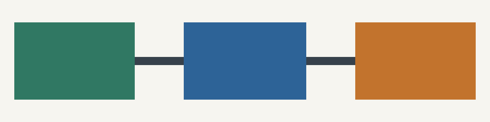

# Illustrated guide

A source-relative image example with chapters, a table and a shared note.

## How export works

Writing, packaging and reading form one export workflow.

| Resource | Illustration |
| --- | --- |
| Reused diagram |  |

A supporting note[^figure].

## A second image

The JPEG is supplied separately from the PNG. Both retain their original bytes.
The divider below is explicitly decorative.

[Return to the diagram](#how-export-works). Read the same note again[^figure].

[^figure]: An image can also appear in a note: .
